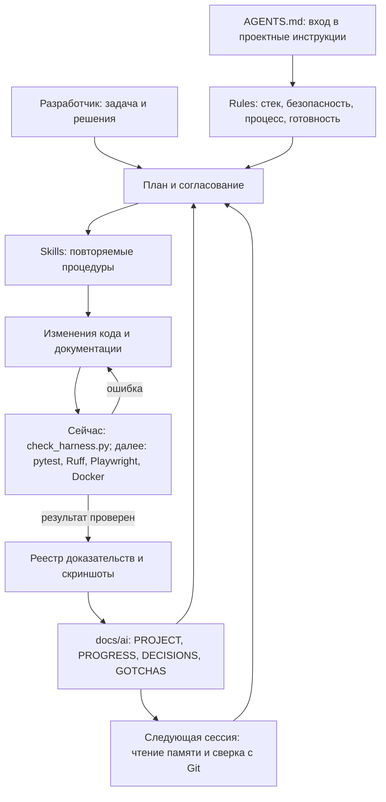

# Архитектура проектного харнесса

Статус: компоненты харнесса настроены на этапе 2; приложение ещё отсутствует.
Codex разрешён преподавателем. Доказательства и E04 см. в PROGRESS.

Экспорт схемы: [PNG](../report/harness.png), [SVG](../report/harness.svg).
Воспроизводимый источник экспорта: [harness.dot](harness.dot).
Команды: `dot -Tpng docs/architecture/harness.dot -o docs/report/harness.png`
и аналогично `-Tsvg` для SVG. Это диаграммы, а не снимки экрана.

| Слой | Проблема | Решение |
|---|---|---|
| Rules | Агент действует непоследовательно или выходит за границы | Короткие обязательные правила; AGENTS.md требует их прочитать |
| Skills | Повторяющиеся задачи каждый раз выполняются по-разному | Узкие процедуры с ресурсами, входами, выходами и проверками |
| Память | Новая сессия теряет договорённости и состояние | Краткие файлы в Git; сверка записей с фактическим кодом |
| Проверки | Правдоподобный код может нарушить функциональность | Исполняемые тесты и проверки с кодом возврата и сохранённым результатом |
| Доказательства | Результат есть, но процесс и приёмку нельзя показать | Реальные снимки, логи, схема и реестр материалов отчёта |
| Разработчик | Агент не должен самостоятельно выбирать все продуктовые решения | Согласование планов, ADR и ответственность за результат |

## Адаптация путей под Codex

По разрешению преподавателя вместо GigaIDE/GigaCode используется Codex.
Входные инструкции находятся в `AGENTS.md`, тематические правила — в
`docs/rules/`, память — в `docs/ai/`, а проектные навыки — в
`.agents/skills/<name>/SKILL.md` вместо `.gigacode/skills/`. Ресурсы навыка
хранятся рядом в `scripts/` или `references/`. Эти пути ограничены проектом;
они не изменяют глобальную конфигурацию и не доказывают автоматическое чтение
правил. Доказательства сохраняются в `docs/report/` и его реестре.

## Границы

- Только текущий репозиторий: AGENTS.md, docs/rules/, docs/ai/, .agents/skills/.
- Глобальные настройки Codex, чужие навыки и проекты не изменяются.
- Уже существующие глобальные инструкции могут наследоваться; проектные
  файлы не являются изоляцией ОС или заменой системных разрешений.
- Проектные правила не считаются автоматически прочитанными только из-за
  наличия .md: AGENTS.md должен явно требовать их чтение.
- Локальные процедуры не отменяют явные инструкции пользователя.
- Внешние навыки проверяются и закрепляются на конкретной версии; шаблоны
  вызовов и ресурсы адаптируются к доступным возможностям Codex.
- Новая сессия и реальные вызовы навыков демонстрируются фактически.

Официальные источники для адаптации:
- [Навыки и поиск проектных каталогов](https://learn.chatgpt.com/docs/build-skills)
- [Проектные инструкции AGENTS.md](https://learn.chatgpt.com/docs/agent-configuration/agents-md)
